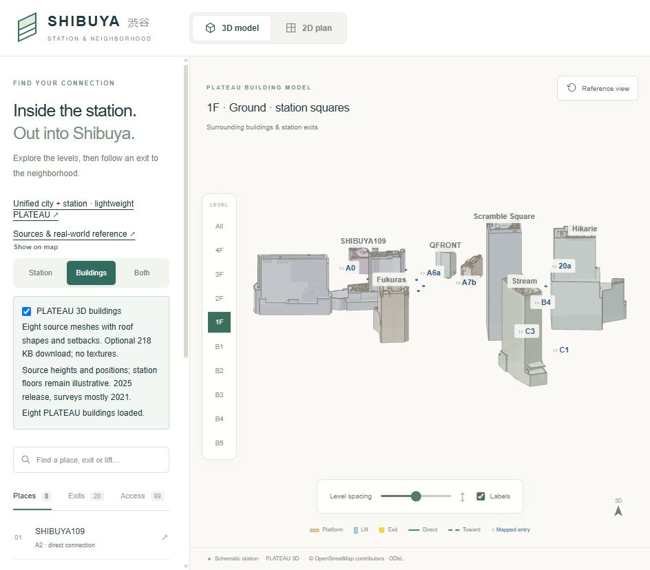
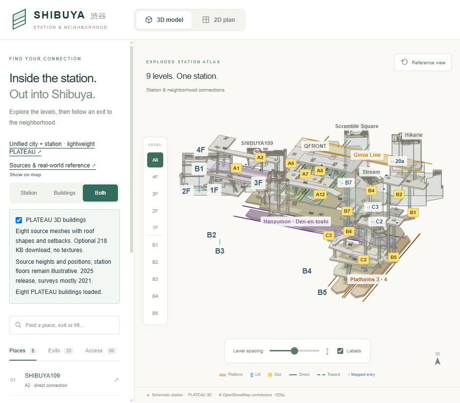
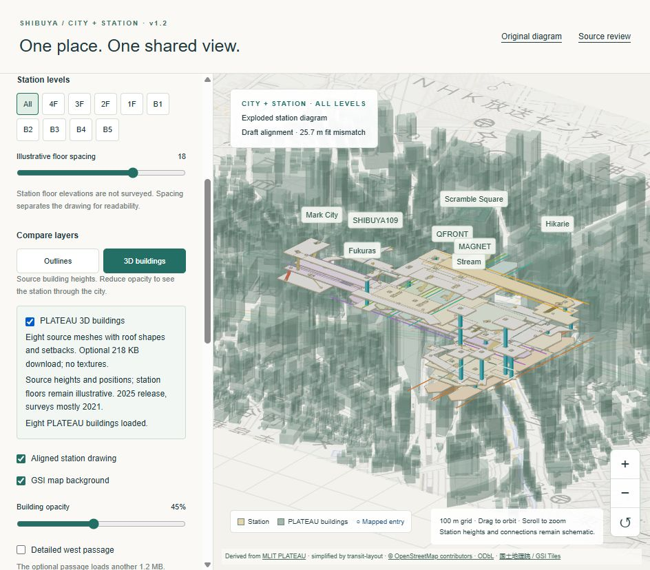

# Optional PLATEAU building meshes — 10 October 2026

The original station model and unified city view can now render the actual source meshes for all eight matched destinations: SHIBUYA109, QFRONT, MAGNET, Mark City, Hikarie, Scramble Square, Stream and Fukuras. This extends the shared outline work. Source roof shapes, setbacks and heights are retained; textures are omitted and materials are replaced for a small, readable architectural model.

## Use

- Original diagram: choose **Buildings** or **Both**, then enable **PLATEAU 3D buildings**. Buildings mode shows solid forms; Both keeps buildings translucent around the station.
- Unified map: enable **PLATEAU 3D buildings**. This switches to 3D building context. Building opacity remains adjustable. Other neighbourhood buildings retain the existing lightweight envelopes.
- Turn the option off to return to simple envelopes. The 2D/north-up plans keep the same shared outlines. The source option remains selected when returning to 3D, without redownloading during the same page session.

The switch is off by default. Loading/error status is visible, a failed download leaves the simpler model available, and Retry can request the file again. No full ward archive, source textures or additional 3D runtime is required.

## Geometry and resource budget

| Item | Result |
| --- | --- |
| Optional asset | `public/plateau/station-buildings.glb` |
| Download size | 218,308 bytes (about 218 KB), before HTTP compression |
| Source buildings | 8 |
| Retained source triangles | 17,237 |
| Images/textures | None |
| Default city geometry | Unchanged at 645,153 bytes |
| Source generation | PLATEAU Shibuya ward 2025 release; surveys mostly 2021 |

The generator reads only the six pinned source tiles containing these buildings, using the same feature IDs and source hashes as the compact-city derivation. It retains every selected source triangle and its winding, deduplicates equal float32 positions into indexed geometry, and strips texture data. No decimation, roof reconstruction or independently fitted building offset is applied.

The [asset provenance record](../../public/plateau/station-buildings.json) gives source URLs, per-building triangle counts/bounds, source tile checksums, identities and attribution. Geometry derives from MLIT PLATEAU; the five inferred identities remain linked to the separately attributed OpenStreetMap crosswalk.

GLB SHA-256: `4ea08e1653f8e15f340277bb25b11916d53c715d61611519424dea7b5802723d`

## Alignment and limits

The GLB retains the shared east/up/south metric frame and ellipsoidal heights. The geographic view subtracts the existing 55 m display reference plane. The original diagram applies the inverse horizontal station similarity and the same uniform scale vertically. This preserves building proportions, relative source elevations and plan correspondence. Floor separation affects only the schematic station, not source building height.

The 55 m plane is a display reference, not local terrain or a measured station floor. The original **25.7 m RMS** station-fit mismatch remains unchanged. Source meshes do not validate entrances, interior geometry, access, or present construction. The three named PLATEAU identities and five inferred cross-source identities retain their previous evidence status. The [photo checklist](photo-verification.md) still applies.

## Reproduction and checks

With the existing source audit cache and pinned Python dependencies available:

```sh
python scripts/build_plateau_buildings.py
npm test
python -m unittest discover -s tests -p 'test_*.py'
npm run build
```

The generator rejects mismatched source hashes, missing building fragments and an optional mesh file over 500 KB. Running the application/tests uses the shipped asset, not the large source cache.

Forty application tests and nine Python tests pass for v1.3.0. New checks cover source identities, every exported triangle count, finite/in-range vertices and indices, source bounds within 1 mm of decoded coordinates, equal positions/heights in both frames, uniform scaling, immutable source geometry, and indexed-export winding/determinism. An independent projection of the shipped GLB matches the separately derived plan envelopes within the 0.27 m simplification/quantization allowance and their base/top heights within 6 mm. Production compilation, lint, type checking and static export pass. See the [final release validation](v1.3-validation.md) for browser resource and idle-render checks.

Browser checks cover optional loading, solid/translucent building context, reverting to simple geometry, selection and 2D fallback. In the original Buildings view the complete scene rendered 18,821 triangles; with the station it rendered 48,421. The unified all-level scene with source buildings rendered 98,197 triangles. These are scene counters, not frame-rate benchmarks; full 3D is optional and the default flat map stays lightweight.

## Previews






