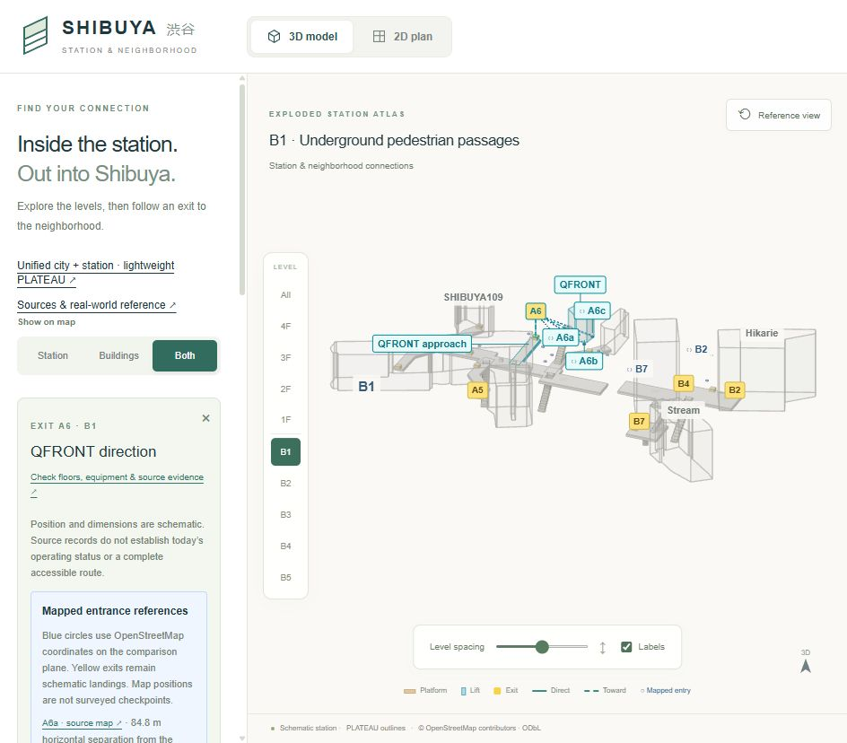
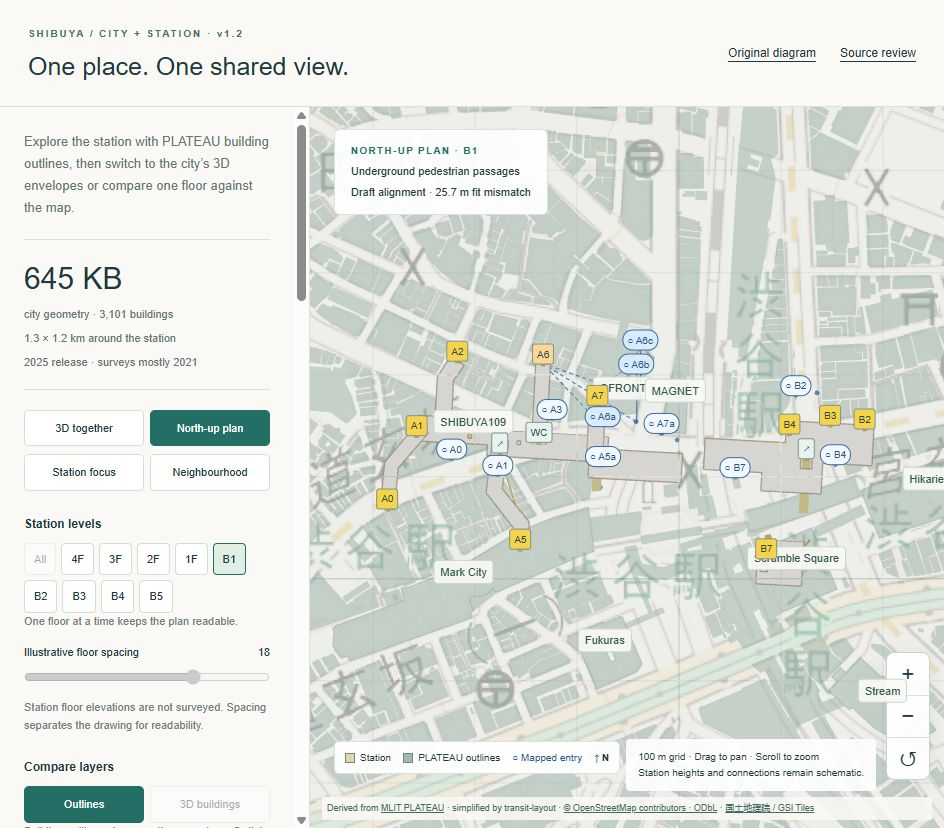
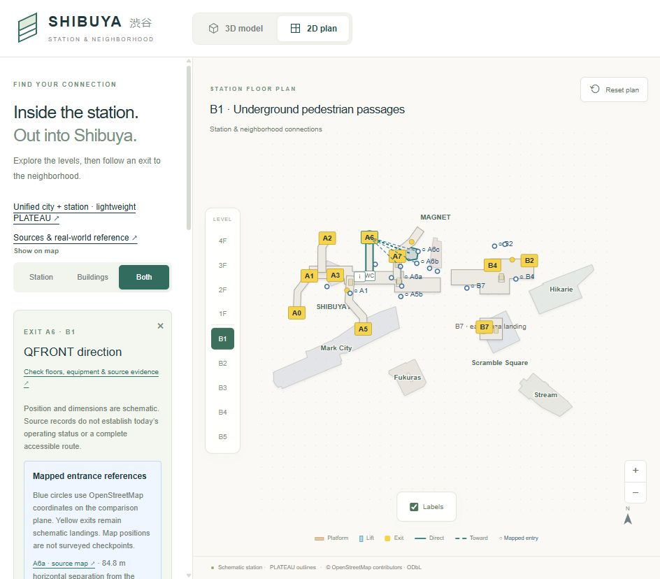
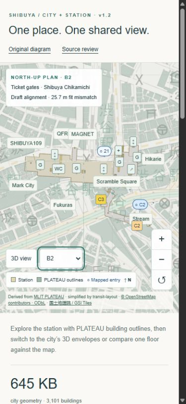

# Public alignment before photos — 10 October 2026

Released in v1.3.0 after v1.2.0. All eight destination buildings now use the same PLATEAU plan outlines in the diagram, SVG plan and unified city view. Twenty-one publicly mapped entrance references have been added at their geographic coordinates. These changes improve reference placement and comparison; they do not establish surveyed station interiors or complete entrance-to-landing routes. The [final v1.3 validation record](v1.3-validation.md) covers the complete release.

The subsequent [optional source-mesh layer](plateau-3d-buildings.md) adds actual PLATEAU roof shapes and heights for these eight buildings in both 3D views. The shared plan outlines and original station fit described here remain unchanged.

## Shared building outlines

The source is the existing 645,153-byte compact city, derived from the PLATEAU 2025 release (surveys mostly 2021). Its coordinates, heights and simplification are unchanged. The plan polygons are projected mesh envelopes, including upper-storey overhangs where present; they are not verified ground-contact footprints. All parts and holes are preserved. The diagram retains illustrative building heights; the city view retains source heights.

Hikarie, Stream and Mark City already had identities in the PLATEAU metadata. The five additional identities below are inferred by comparing named OpenStreetMap building polygons with every compact PLATEAU envelope in the same east/south metric frame. Each has a unique strong overlap. This is evidence for a match, not a survey or an official PLATEAU name assignment.

| Destination | OSM way | Intersection / union overlap | Next-best overlap |
| --- | --- | ---: | ---: |
| SHIBUYA109 | [55895868](https://www.openstreetmap.org/way/55895868) | 94.3% | 0% |
| QFRONT | [136691386](https://www.openstreetmap.org/way/136691386) | 89.6% | 0% |
| MAGNET | [116806281](https://www.openstreetmap.org/way/116806281) | 95.6% | 0% |
| Scramble Square | [617560918](https://www.openstreetmap.org/way/617560918) | 87.6% | 1.2% |
| Fukuras | [55588118](https://www.openstreetmap.org/way/55588118) | 92.7% | <0.1% |

The [identity crosswalk](../../public/evidence/building-crosswalk.json) records feature IDs, source edit dates, overlap scores and attribution. No additional PLATEAU archive is required in the browser. The eight outlines are a 3,652-byte subset; the full city asset is not imported into the original diagram bundle.

The original similarity fit is deliberately frozen: translation, uniform scale 1.7885049374 and rotation approximately 3.1142°. The original three control residuals remain Hikarie 26.0 m, Stream 31.7 m and Mark City 17.4 m, with **25.7 m RMS**. Leave-one-out mismatch remains 63–114 m. New shared outlines are inverse-transformed into the drawing frame for display, not reused as independent controls. Station slabs, landings, equipment records and the baseline evidence fingerprint are unchanged.

## Entrance references

The [entrance reference records](../../public/evidence/entrance-references.json) contain 21 named OSM nodes, their WGS84 coordinates, version/edit date, source floor tag and target feature identity. References appear as blue circles on a flat comparison plane in Both/Buildings and the unified map. Selecting an associated exit or lift shows a dashed horizontal comparison line and distance. Yellow exit markers retain the schematic landing position. Lines compare positions; they do not describe walking paths.

| Match class | References | Limitation |
| --- | --- | --- |
| Exact parent exit code | A0, A1, A3, A4, B1, B2, B3, B4, B7, C1, C2, C3 | Same code does not establish the passage geometry between the public map point and schematic landing. |
| Grouped branch code | A5a/b, A6a/b/c, A7a/b | Associated with parent A5, A6, A7; individual branch connections are unverified. |
| Equipment reference | 20a, 21 | Associated with the explicitly identified Tokyu lift; source map geometry is not a surveyed shaft position. |

Codes were cross-referenced against the [Tokyu Shibuya station plan](https://www.tokyu.co.jp/railway/station_map/pdf/ty01-shibuya_2.pdf), whose main plan is dated 21 August 2026. Some inset material carries older dates. This check does not refresh the complete September operator/equipment audit or establish live operation. OSM edit dates are not observation dates. The C2 node carries level `-2`, A6a/b carry level `0`, and the other accepted nodes have no floor tag. No elevation is inferred from these records. The floor filter controls comparison visibility, not measured floor assignment.

Five records with missing/legacy references were excluded from automatic matching: codes 8 and 15, and three unnamed nodes. No renumbering is assumed. The selected public extract has no accepted current-code reference for **A2, A8, A12, B5 or B6**. Absence here does not mean an entrance is absent in reality.

Horizontal separations range from 34.1 m (B3) to 179.2 m (B1). For example A1 is 88.3 m and C3 is 113.6 m. These combine drawing distortion, source uncertainty and real approach distances between different kinds of point. They are **not entrance error estimates** and must not be used to snap the underground landings to the public map.

The official [MLIT Shibuya/Sendagaya/Shinjuku pedestrian network catalogue](https://ckan.hokonavi.go.jp/dataset/nwd_shibuya_sendagaya_shinjuku) was also inspected. The network was last updated 26 May 2021. Its node coordinates/floor tags do not identify current exit codes, so proximity alone was insufficient for matching. It is not shipped or used as an alignment control.

## Payload, provenance and reproduction

| Data | Uncompressed bytes | Loading |
| --- | ---: | --- |
| Existing city geometry | 645,153 | Unified view only; unchanged |
| Eight shared PLATEAU outlines | 3,652 | Small presentation subset |
| Entrance reference evidence | 9,757 | Small shared reference layer |
| Building identity crosswalk | 2,588 | Evidence link; no geometry duplication |

The new reference data totals 15,997 bytes before bundling/compression; this is not a measurement of total page transfer. Rendering remains on demand. The detailed passage and full ward viewer remain optional. Raw OSM and MLIT downloads remain in the ignored audit cache.

PLATEAU geometry keeps its existing attribution. OSM-derived entrance records and the identity crosswalk are distributed under **ODbL 1.0**, with **© OpenStreetMap contributors** visible in both views; see the [copyright and licence notice](https://www.openstreetmap.org/copyright). Source record URLs and timestamps are retained; contributor account metadata is not shipped.

The reviewed OSM snapshot was obtained from the [official map API](https://api.openstreetmap.org/api/0.6/map?bbox=139.696,35.655,139.706,35.662) on 10 October 2026. Checksums:

- City SHA-256: `3394a1eea2d253a53782b5be952fbf30e50231e2a4b70847cbc3fb27b7dc83b9`
- OSM source SHA-256: `0aa039074060ae099dc5aa2274226a2abc5ff03e57ce2fdec167e4d716025fa7`

With that snapshot at `.cache/shibuya-osm.xml` and the pinned Python requirements installed, run `python scripts/build_public_alignment.py`. The generator rejects changed input hashes so newer data cannot silently inherit this review's date. A later API response may differ; review its matches and update the snapshot/date explicitly. Source archives are not needed to run the application or its regression tests.

## What still needs the user

The [photo checklist](photo-verification.md) records the next evidence to provide. Priorities are missing/branched entrance signs with wider street context, C2's floor transition, lift panels, and the Keio West works/access state. Photos can resolve identity and topology. Dimensioned plans or survey coordinates, including vertical datum, are still needed to replace the schematic interior geometry.

## Validation

At this outline/entrance checkpoint, 37 application and seven Python tests passed, including all-eight-outline parity, source-asset immutability, frozen station controls, exact reference coordinate preservation, branch/source-floor safeguards and payload limits. The geometry suite triangulates all shared parts and holes in both presentation frames. The complete v1.3 release subsequently passes 40 application and nine Python tests; see the [final record](v1.3-validation.md).

The final production build passed compilation, lint, type checking and static export. Desktop checks covered the original 3D and SVG views, Both mode, floor isolation, named/inferred building selection, north-up and source-height city views, A1 distance parity (88.3 m in both frames), grouped A6 references, C2's source floor and the entrance-layer toggle. The 390 × 844 phone check confirmed floor controls, C2 selection, visible attribution and no horizontal page overflow; the temporary viewport override was reset. No browser errors were recorded. Existing Three.js deprecation and outdated Browserslist warnings remain non-fatal.

The default all-level unified scene still renders 21,493 triangles (182 draw calls). The selected A6/B1 north-up comparison renders 17,109 triangles (66 draw calls). These are scene counters, not a device frame-rate benchmark. Five extra individually identifiable buildings add selection/edge work, while the compact city geometry remains unchanged.

These changes are included in v1.3.0 on `codex/v1.3-plateau-alignment`. Preview both pages at `/transit-layout/` and `/transit-layout/area/`. In the original diagram choose Both, B1 and Exit A6; in the unified map choose North-up plan and Exit A6 to compare the same three public references.

