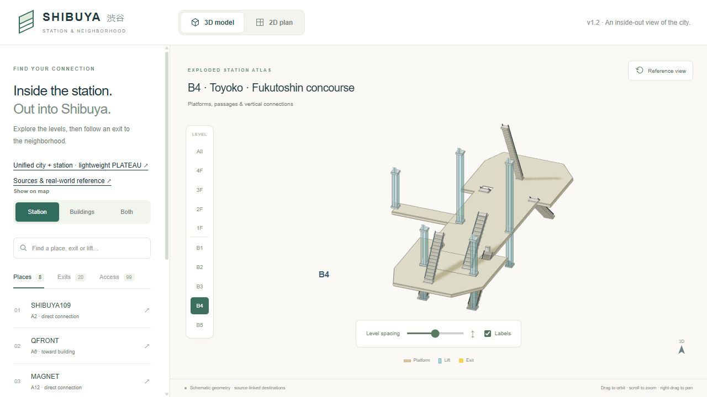
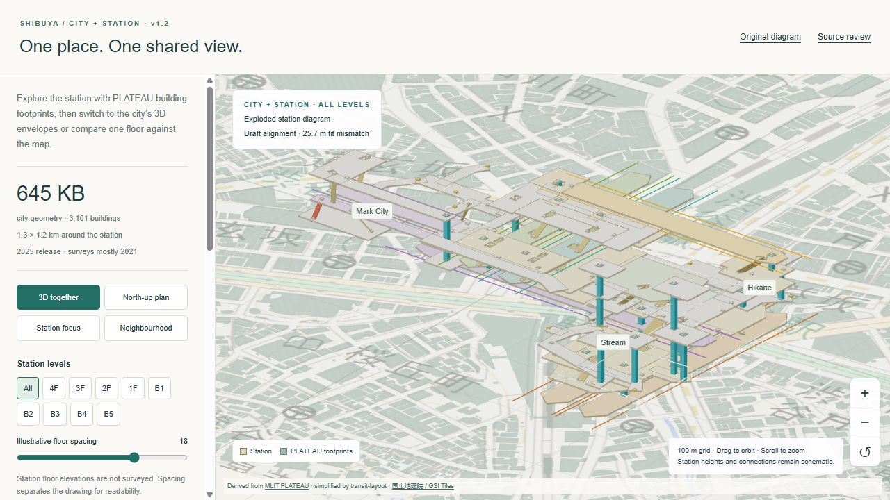
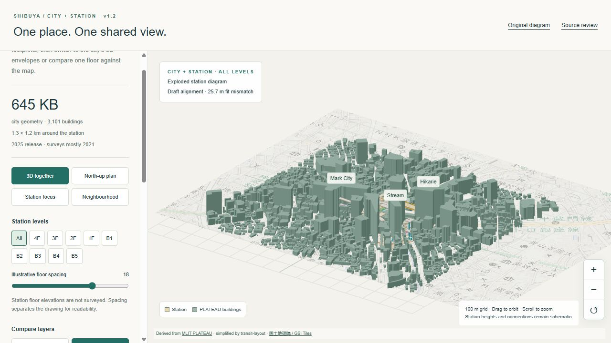
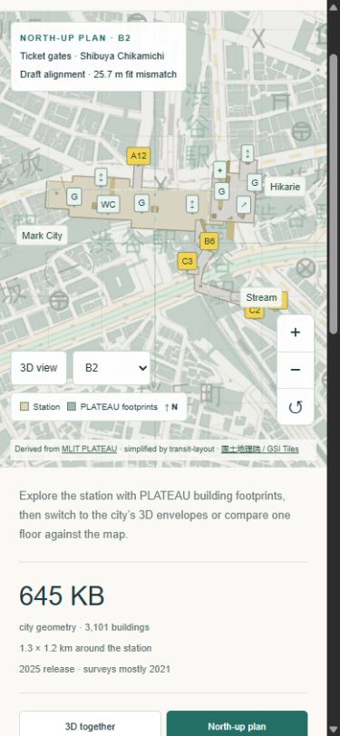

# v1.2.0 presentation validation

Checked on 10 October 2026 against the preserved v1.1.0 production preview. The scope is clearer 3D presentation and map comparison; this is not a new geographic or operator-source survey.

## Findings addressed

- v1.1 floor filtering hid other floors but retained their camera bounds, leaving an isolated floor small and off-centre. Both 3D viewers now frame visible geometry. The original diagram also excludes hidden floor labels from framing and uses the drawing area's existing control gutters.
- Transparent city envelopes overlapped into a dense visual background. Station focus now uses flat source footprints; Neighbourhood uses opaque source-height envelopes. Both use the same compact city data, including its polygon holes and concave boundaries.
- All levels overlapped in north-up comparison. The plan now shows one selected floor, initially 1F when leaving the all-level overview. Its signed floor name stays visible.
- The mobile map required scrolling away from the model to change view or level. Direct map controls now expose both, with zoom and reset available on all screen sizes.

## Validation

| Check | Result |
| --- | --- |
| Application tests | 32 passed. New coverage checks hidden geometry during framing, every floor in both coordinate frames at desktop and phone proportions, empty camera targets, and all 3,123 published city polygon parts as flat footprints. |
| Python geometry/import tests | Seven passed. |
| Production build | Passed compilation, lint, TypeScript and seven-page static generation. |
| Desktop browser | Original 3D floor focus, default unified overview, north-up comparison, Neighbourhood preset, zoom/reset and source-feature selection worked. Selecting Keio stairs C from the city view restored a readable station view and retained its dated closure evidence. |
| Mobile browser | Tested at 390 × 844: direct B2 selection, north-up/3D switching and zoom/reset worked. Temporary viewport overrides were reset afterward. |
| Browser errors | None recorded in the tested production views. The upstream Three.js Clock warning remains. |

The local build still warns that its Browserslist dataset is old. This does not prevent compilation or rendering. The release branch workflow repeats the tests and build on Linux.

## Rendering and evidence boundaries

The default unified all-level scene reports **21,493 rendered triangles and 172 draw calls**, compared with **81,444 triangles and 176 draw calls** in v1.1: approximately 74% fewer triangles. These are scene counters, not a frame-rate or device-wide memory benchmark. Flat footprints use a single rendering pass; the existing 1.25 maximum pixel ratio and on-demand rendering remain in place, with antialiasing enabled for smoother edges.

The city file remains **645,153 bytes**. Its SHA-256 is unchanged:

`3394a1eea2d253a53782b5be952fbf30e50231e2a4b70847cbc3fb27b7dc83b9`

Source building coordinates and heights, station model coordinates and equipment records are unchanged. The existing model fingerprint test passes. Footprints are explicitly a flat map display; they do not replace the source elevations. The [v1.1 source audit](final-geometry-audit.json) remains the source-geometry baseline.

The geographic fit is still provisional at 25.7 m RMS against three building centres, with no independent surveyed entrance checkpoints. Public sources were last reviewed on **19 September 2026**. The [photo checklist](photo-verification.md), current operation checks and measured alignment remain pending.

## Production previews









## Reproduce

```sh
npm ci
npm test
python -m pip install -r scripts/requirements-plateau.txt
python -m unittest discover -s tests -p 'test_*.py'
npm run build
npm run preview
```

Open `/transit-layout/` and `/transit-layout/area/` on the preview server. Compare All/B4 in the diagram; switch between station focus, north-up and Neighbourhood in the unified view. Source archives are not needed for this presentation pass and remain outside Git and the default browser download.
