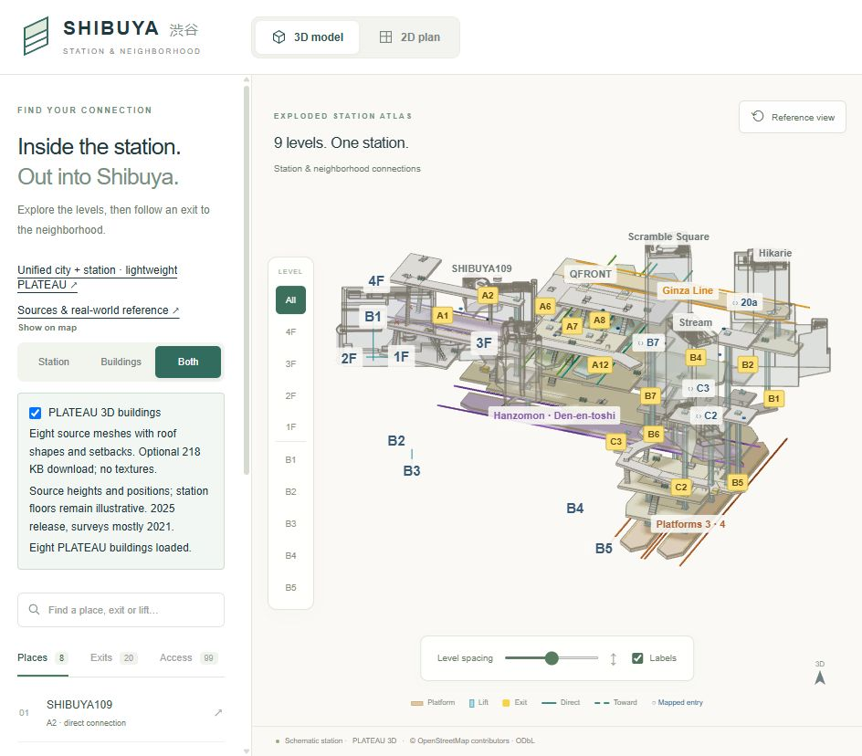
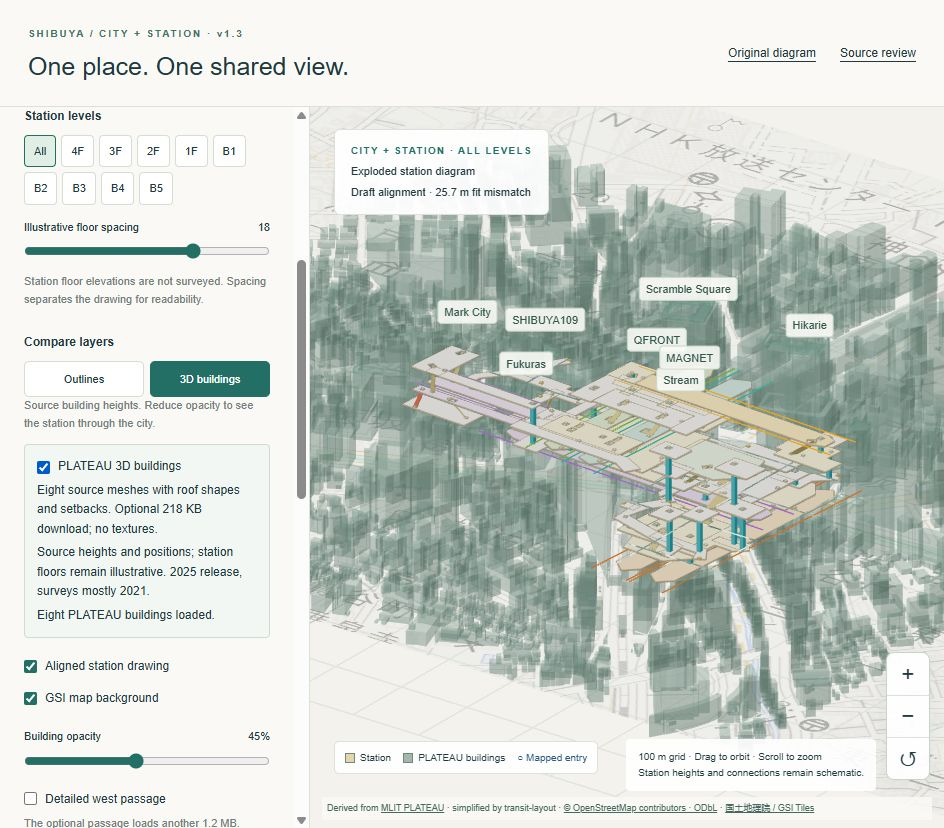
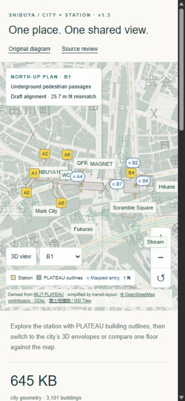
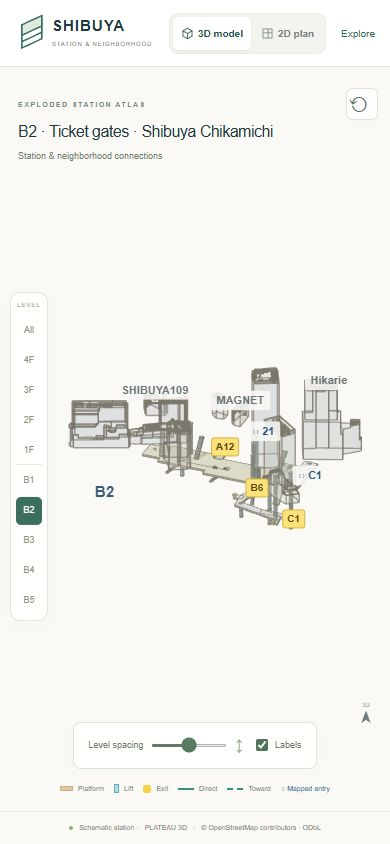

# V1.3 final alignment and performance checks

Release: **1.3.0**, 10 October 2026. Branch: `codex/v1.3-plateau-alignment`.

The shared building geometry and station rendering pass internal alignment and resource checks. The release is ready for comparison and later photo verification. It is not a surveyed station model: the original **25.7 m RMS building-centre fit** and unknown station floor elevations remain explicit.

## Alignment results

- All eight named destinations use the same PLATEAU feature IDs, plan parts and holes in the diagram, SVG plan and geographic view. Three identities come from PLATEAU metadata; five are inferred from the separately attributed public building crosswalk.
- The optional GLB contains all **17,237 source triangles** for those eight buildings. Regenerating it from the six pinned source tiles reproduced the exact SHA-256 `4ea08e1653f8e15f340277bb25b11916d53c715d61611519424dea7b5802723d`.
- Every source vertex returns to the same horizontal coordinates and height in both display frames within the test tolerance of `1e-8` m. The diagram uses the inverse original horizontal fit and uniform vertical scaling; there is no extra per-building offset or floor-spacing deformation.
- An independent Python projection of the shipped GLB agrees with the separately derived shared plan envelopes: neither projected area extends beyond the other's **0.27 m** buffer, apart from an allowance below 0.001 m². This covers the existing 0.25 m simplification, centimetre quantization and float32 conversion. Source base/top heights agree with rounded envelope heights within **6 mm**. These are internal data tolerances, not real-world accuracy estimates.
- Original and geographic floor slabs, connector openings, concavities and holes triangulate without reflection or missing area. Every declared connector stop is supported by its floor slab; exit anchors touch or lie inside the associated passage. The WGS84 transform agrees with Cesium's independent coordinate conversion across the neighbourhood.
- Twenty-one public entrance references retain their WGS84 coordinates, source floor tags, IDs and conservative code matches. Station landings, the original three fitting controls and the operator evidence fingerprint remain unchanged. A5/A6/A7 branch nodes are comparison references, not separately established routes.

The 55 m ellipsoidal display plane is not surveyed terrain or a station floor. Projected building envelopes may include upper-storey overhangs. PLATEAU 2025 geometry largely reflects 2021 surveys. The October building/entrance update does not re-date the September operator review or confirm current construction/access.

## Performance and browser checks

Production export tested in the desktop in-app browser at its normal 944 × 828 viewport and at a 390 × 844 phone viewport. Resource counts below are renderer diagnostics, not FPS, heap measurements, network timing or a physical-phone benchmark.

| View / configuration | Triangles | Draw calls |
| --- | ---: | ---: |
| Original diagram, default station, all levels | 29,840 | 646 |
| Original diagram, Both, source buildings, all levels | 48,421 | 704 |
| Original diagram, Both, source buildings, B2 only | 24,517 | 187 |
| Unified map, default outlines, all levels | 21,493 | 182 |
| Unified map, source buildings, all levels | 98,197 | 182 |
| Unified map, B2 with outlines | 17,157 | 69 |
| Unified north-up plan, B1 | 17,109 | 63 |

- The default city remains **645,153 bytes** with 3,101 buildings. The eight optional source meshes add **218,308 bytes** without images/textures. These are geometry file sizes before HTTP compression, not total page downloads. The shared outline subset is 3,652 bytes; entrance references and the crosswalk total 12,345 bytes.
- Source buildings are off by default. The load is enabled only in a 3D context; turning it off restores simple geometry. Going to a flat plan and back reuses the cached source data. Full-ward tiles and the optional west passage remain separate choices.
- Three off/on cycles in each all-level source-building view left renderer resources stable: **573 geometries** in the original scene, **173 geometries and 10 textures** in the unified scene. Geometry revisions changed only for replacements. This checks the exercised paths, not every possible long-session allocation.
- After those cycles, rendered-frame counters remained unchanged at **9** and **11** across subsequent idle observations while other validation work ran. Rendering resumes for interactions; there is no continuous idle render loop.
- Desktop and phone-width controls were checked for building loading, floor isolation, north-up comparison, and original 2D/3D switching. Both mobile layouts fit their viewport without horizontal document overflow. A selected floor keeps the station readable; the full all-level view is denser.
- No browser console errors were observed. The production build reports roughly 125 KB initial JavaScript for the homepage and 122 KB for `/area`; those figures exclude subsequently loaded rendering chunks, geometry and map tiles.

## Automated and production validation

**49 tests passed:** 40 application tests and nine Python tests. Production compilation, lint, type checks and static export passed. The source-mesh regeneration produced the same 218,308-byte asset. The compact city checksum is unchanged. Existing non-failing Three.js deprecation and Browserslist-age notices remain.

```sh
npm ci
npm test
python -m pip install -r scripts/requirements-plateau.txt
python -m unittest discover -s tests -p 'test_*.py'
npm run build
npm run preview
```

The Python environment on the validation machine is `.cache/plateau-venv`. The tests use shipped reference assets and do not require the large raw source cache. Regenerating source meshes additionally requires the pinned six-tile audit cache and `python scripts/build_plateau_buildings.py`.

## Still needs user evidence

The [photo checklist](photo-verification.md) is the handoff for later field evidence. Priorities are:

1. Entrance signs and wide context for **A2, A8, A12, B5 and B6**, plus separate A5/A6/A7 branch signs.
2. **C2's floor transition**, B1/C3 approach sequences, and building corners/overhangs that distinguish ground entrances from upper-level envelopes.
3. **Keio West** access and works notices; **SHIBUYA109 and Tokyu lift** identification and stop panels.
4. Both landings, nearby signs and direction arrows for unresolved escalator/stair banks, plus paid/unpaid boundaries and operating-hours notices.

Retain original photos and capture dates, with signed floor and exit/gate names. Photos can resolve identity, topology and dated access observations. Improving metric accuracy requires measured plans or survey controls with units, coordinate system, vertical datum and independent check points; ordinary photos alone do not replace those.

## Release previews








