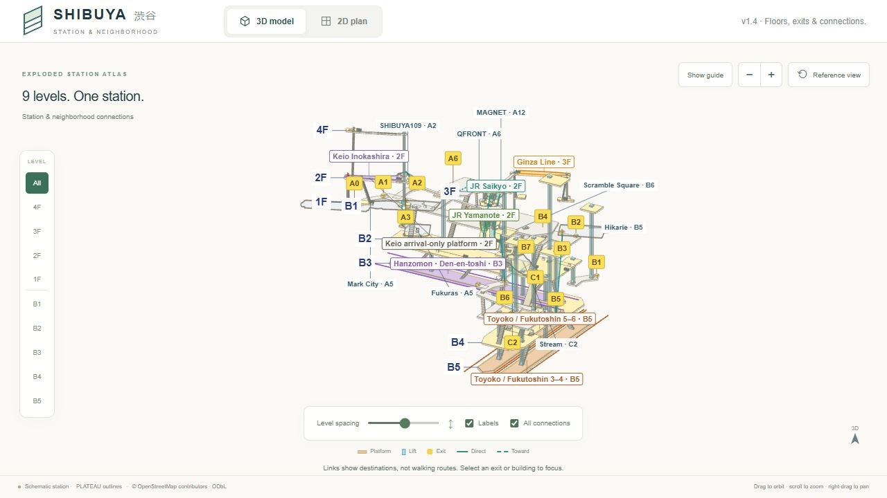
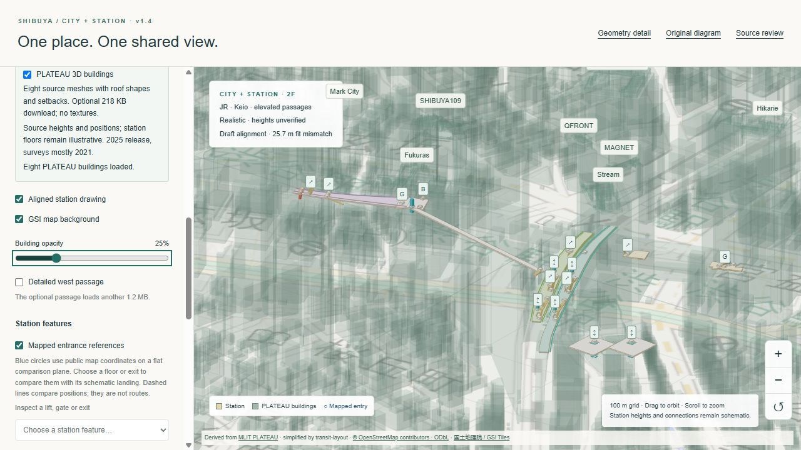
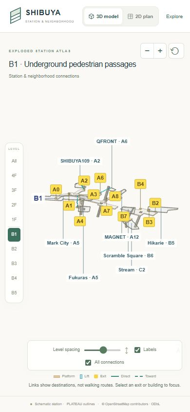
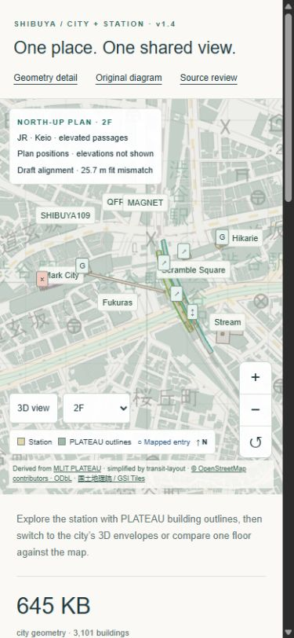

# V1.4 diagram clarity and alignment

**Release 1.4.0 — 11 October 2026.** Branch: `codex/v1.3-plateau-alignment`; tag: `v1.4.0`. Preview: `http://127.0.0.1:3108/transit-layout/` after a production build.

## What changed

The homepage now opens in **Exploded / Both** with 30 drawing units between floors. Cream concourses, light passage slabs, line-colored platforms, cyan lifts, yellow exit badges and stronger outlines echo the supplied operator illustration. Blue floor callouts attach to actual slab vertices chosen in screen space; their labels no longer use an empty corner of a floor's enclosing rectangle. Floor labels are 15 px on desktop and 14 px on narrow canvases; platform labels are 11 / 10 px, and secondary callouts are 10 px. Reduced padding keeps the geometry prominent while yellow exit codes retain 11 px text. Platform callouts include floor names, and the two bottom islands identify Toyoko / Fukutoshin and their platform numbers. Callout placement changes labels only, never station coordinates.

All eight destination buildings use their existing shared PLATEAU plan envelopes as flat context in the exploded view. This keeps towers from obscuring the floor layouts. **Realistic** retains the source-height envelope / optional source mesh comparison and the explicit station height assumptions. Optional source meshes are not fetched for the exploded view. The geographic view continues to use the same canonical outlines and platform corrections.

Eight exit-to-building associations are visible in the overview. Solid lines indicate documented direct connections; dashed lines indicate an exit toward a destination. Their endpoints lie on the nearest outer PLATEAU envelope, including multipart shapes; courtyard holes are excluded. These endpoints are visual anchors, not verified doorways. The lines do not invent a vertical lift, interior route or accessible path. In particular, A5 remains directional toward both Mark City and Fukuras. Mark City selection shows only its own A5 link. B5 remains an exit code on B3, and A12 remains on B2.

**All connections** controls the unselected overview; selecting an exit or building shows only that feature's associations. Floor filtering also filters the connections. **Expand diagram**, zoom buttons and the existing enlarged [geometry detail](platform-size-detail.md) page support closer inspection. **Reference view** clears selection and restores the exploded overview. Detailed floor/height evidence is available in **Alignment & heights to verify**.

## Included alignment and size work

This release also contains the preceding [Keio / Mark City](keio-mark-city-alignment.md), [Ginza / JR](ginza-jr-alignment.md) and [platform-size](platform-size-detail.md) corrections. Keio platforms and Central gate are 2F, West gate is 1F and Avenue is 4F. Ginza platforms are 3F; JR platforms are 2F. Public platform boundary vertices and both mapped JR openings are shared by the diagram, geographic view and dimension view. Removing the decorative slab bevel prevents a roughly 0.36 m horizontal expansion per edge.

These local corrections do not alter the original three global fit controls or their provisional **25.7 m RMS building-centre mismatch**. Underground shapes, gate/equipment positions and transfer approaches retain their documented schematic or inferred status. Known floor names are not measured elevations. Realistic still assumes 5 m floor intervals above an unverified 1F datum, tied to the 55 m ellipsoidal comparison plane. PLATEAU surveys mostly date to 2021, before recent JR reconstruction.

## Validation

- **60 automated tests pass: 51 application and nine Python tests.** Added cases cover outer-envelope association anchors, multipart buildings, courtyard exclusion, floor/selection filtering, no invented destinations, and unclipped floor callouts at narrow and desktop widths. Existing geometry, registered-coordinate, source-mesh, platform-size, landing and source-evidence checks pass.
- Production compilation, lint, type checking and static export pass. Initial homepage JavaScript remains about **131 KB**; this excludes lazy rendering chunks and optional geometry.
- Desktop browser checks cover overview / isolated floors, expanded canvas, zoom, selected A5's two links, Mark City's single directional link, Realistic source buildings, and return to the reference view. Selection and floor filtering preserve the allocated station model.
- Phone-width controls are checked at **390 × 844**. The drawing gets smaller label text and reduced side gutters; floor filtering and zoom are available without opening the sidebar. The all-level overview remains dense on a narrow screen. Use a single floor or the 2D plan to inspect exits; collision handling deliberately hides lower-priority labels instead of printing them over each other.
- The final source-cache audit checks **122 pinned tiles, 3,101 buildings and 3,123 valid polygon parts**, representing 469,945 source triangles. All tile hashes and the compact-city checksum match. Maximum envelope-bound difference is 0.207 m and vertical quantization is below 5 mm; these are processing tolerances, not station survey accuracy. Station checks retain 59 valid slabs, 20 attached exit anchors, 135 supported connector stops and 35 supported facilities in each audited frame. The older audit's `drawing` frame is the baseline dataset; the application tests additionally check the corrected shared schematic and geographic frames.
- The independent platform-size and Ginza/JR envelope-overlap reports reproduce from the shipped inputs. The Ginza/JR report now normalizes its source hash to UTF-8 / LF, like the size report, so Windows and Linux checkouts give the same evidence fingerprint. No platform coordinates or overlap results changed during this release pass.
- Final browser checks found no console errors. Both mobile views fit without horizontal document overflow. The map's North-up control and mobile floor selector work, and Realistic remains explicitly marked as having unverified station heights. Switching the optional source buildings off and on preserves the map's allocated geometry and texture counts for the exercised 2F view.

Renderer diagnostics from the final release check (counts are not FPS or a physical-device benchmark):

| Configuration | Rendered triangles | Draw calls | Visible destination links |
| --- | ---: | ---: | ---: |
| Exploded overview, flat outlines | 22,656 | 567 | 8 |
| Exploded B1 floor, flat outlines | 2,616 | 94 | 4 |
| Realistic 2F, optional PLATEAU source buildings, links off | 25,993 | 223 | 0 |
| Unified map, Realistic all levels, flat outlines | 24,953 | 182 | — |
| Unified map, Realistic 2F, source buildings, 25% opacity | 94,541 | 84 | — |
| Unified north-up plan, 3F | 18,312 | 52 | — |

The flat diagram uses unlit materials without station shadow passes, while realistic rendering retains lighting. Rendering remains demand-driven. No city or source-building asset grew: the compact city is **645,153 bytes**, and the optional eight-building source GLB is **218,308 bytes** without textures. No new geometry download is needed for the presentation changes. Source payload sizes are not total page-transfer sizes.

## Still needs photos or measurements

Use the existing [photo checklist](photo-verification.md). Highest-value evidence remains exit signs plus wide building/street context for A2, A8, A12, B5 and B6; separate A5/A6/A7 branch signs; C2's level transition; Keio / Ginza / JR gate and floor signs; and lift stop panels plus both landings of uncertain stair/escalator banks. Capture dates and paid/unpaid context matter.

Photos can resolve identity, floor correspondence and observed access conditions. Exact doorway coordinates, platform elevations, local slopes, widths and connecting passage geometry require measured plans or survey controls with units and a vertical datum. The stronger visual presentation does not upgrade any inferred placement to verified geometry.

## Release previews

